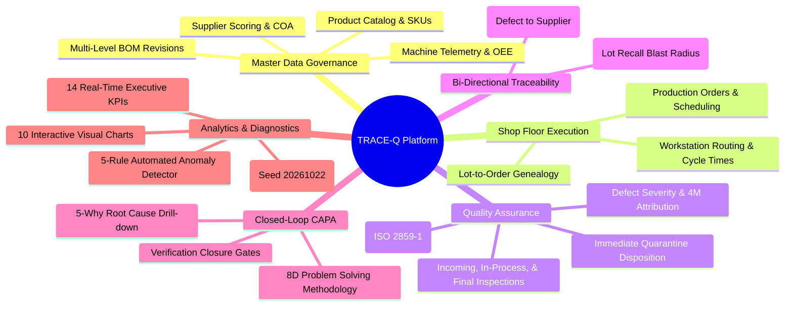
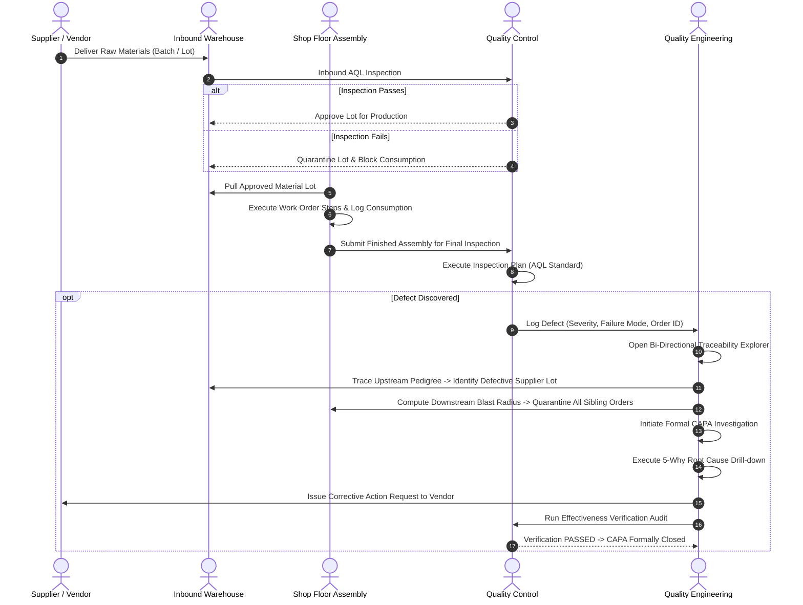

# TRACE-Q: Manufacturing Defect Traceability & Corrective Action System

[](https://manufacturing-defect-traceability-1-8k76.onrender.com)
[](https://github.com/2200030440/manufacturing-defect-traceability)
[](https://manufacturing-defect-traceability-1-8k76.onrender.com/api/docs)
[](https://github.com/2200030440/manufacturing-defect-traceability)

**TRACE-Q** is a full-stack Manufacturing Execution & Quality Management Platform (MES/QMS) providing bi-directional defect genealogy, closed-loop CAPA tracking with 5-Why root cause inquiry, and real-time operational analytics aligned with **ISO 9001** and **IATF 16949** standards.

---

## 1. Live Application & Demo Credentials

- **Live URL**: [https://manufacturing-defect-traceability-1-8k76.onrender.com](https://manufacturing-defect-traceability-1-8k76.onrender.com)
- **API Documentation**: [https://manufacturing-defect-traceability-1-8k76.onrender.com/api/docs](https://manufacturing-defect-traceability-1-8k76.onrender.com/api/docs)

### Demo Accounts

The login screen includes **1-click quick login buttons** for each role, or you can use these credentials:

| Role | Email | Password | Access Scope |
| :--- | :--- | :--- | :--- |
| **System Admin** | `admin@manufacturing.com` | `Admin@123456` | Full system access, data generator, audit logs |
| **Quality Engineer** | `quality@manufacturing.com` | `Quality@123456` | Inspections, defect quarantine, CAPA 5-Why, verification |
| **Production Planner**| `planner@manufacturing.com` | `Planner@123456` | Work orders, BOM revisions, line scheduling |
| **Plant Operator** | `operator@manufacturing.com` | `Operator@123456` | Shop-floor consumption, station execution logs |

---

## 2. How to Run the Project Locally

### Prerequisites
- Python 3.10+ & Node.js 18+
- Git

### Step 1: Clone the Repository
```bash
git clone https://github.com/2200030440/manufacturing-defect-traceability.git
cd manufacturing-defect-traceability
```

### Step 2: Start the Backend (FastAPI)
```bash
cd backend
pip install -r requirements.txt
python -m uvicorn app.main:app --host 0.0.0.0 --port 8000 --reload
```
- The backend API will be running at `http://localhost:8000`
- Interactive Swagger docs will be at `http://localhost:8000/docs`

### Step 3: Start the Frontend (React + Vite)
Open a new terminal window:
```bash
cd frontend
npm install
npm run dev
```
- The web application will open at `http://localhost:5173`

*(The Vite development server automatically proxies API calls to `http://localhost:8000`).*

---

## 3. Running the Automated Tests

The backend test suite covers authentication, role permissions, BOM relationships, supply chain graph traversal, and anomaly detection rules.

```bash
cd backend
python -m pytest tests -v
```

### Test Coverage Summary (10/10 Passed):
- `test_auth.py`: Token generation, role-based authorization, Bcrypt password verification.
- `test_products_bom.py`: Product registration, material linking, and BOM component revisions.
- `test_traceability.py`: Bi-directional traversal from supplier raw lot &rarr; work order &rarr; defect.
- `test_capa_workflow.py`: Defect logging, CAPA opening, 5-Why root cause inquiry, verification gates.
- `test_validation.py`: Primary key uniqueness checks and 5 anomaly pattern detectors.

---

## 4. Project Overview & Mindmap

In high-reliability manufacturing, non-conforming materials can cause severe financial losses and safety hazards. **TRACE-Q** tracks raw material lots through every assembly step to provide complete visibility.



---

## 5. End-to-End Quality Workflow



### Process Stages:
1. **Inbound Receiving**: Materials arrive with lot numbers, vendor certificates, and expiration dates.
2. **Order Execution**: Assembly operators log material consumption directly against work orders.
3. **Station Routing**: Stations capture operational cycle times and machine telemetry.
4. **Quality Inspection**: QA inspectors execute AQL sampling plans and log non-conformances.
5. **Upstream Pedigree Tracing**: Engineers trace defects back to the exact supplier lot.
6. **Downstream Blast Radius**: Suspicious lots are analyzed to quarantine all orders that consumed them.
7. **5-Why CAPA Investigation**: Cross-functional teams drill down to systemic root causes.
8. **Verification Gate**: CAPAs require documented verification proof before they can be marked closed.

---

## 6. What Each Page Does (Visual Walkthrough)

### 1. Role-Based Authentication
<p align="center">
  
</p>

- **Purpose**: Authenticates users with JWT tokens and provides quick login buttons for all 4 roles.
- **Key Features**: 1-click role switcher, Bcrypt password protection, and role-based access control.

---

### 2. Operations & Quality Dashboard
<p align="center">
  
</p>

- **Purpose**: Real-time operational overview for factory leadership.
- **Key Features**: 14 KPI cards (First Pass Yield, Scrap Counts, Defect Rates) and 10 dynamic charts covering failure Pareto distributions, 90-day defect trends, and machine failure heatmaps.

---

### 3. Bi-Directional Traceability Explorer
<p align="center">
  
</p>

- **Purpose**: Identifies root causes and isolates contaminated production batches.
- **Key Features**:
  - **Upstream Mode**: Search by Defect ID (e.g. `DEF-000001`) to trace back to the raw material lot and supplier.
  - **Downstream Mode**: Select a suspect lot to see all work orders and finished units exposed.

---

### 4. Defect Management & Immediate Containment
<p align="center">
  
</p>

- **Purpose**: Centralized non-conformance logging and physical dispositioning.
- **Key Features**: Severity filters (`CRITICAL`, `MAJOR`, `MINOR`), disposition tagging (`SCRAP`, `REWORK`), and 1-click CAPA escalation.

---

### 5. Closed-Loop CAPA & 5-Why Investigation
- **Purpose**: Eliminates recurring quality issues using the 8D methodology.
- **Key Features**: Interactive 5-Why drill-down form, assigned corrective/preventive action milestones, and formal verification gates (`PENDING` &rarr; `PASSED`/`FAILED`).

---

### 6. Automated Anomaly Detection
- **Purpose**: Scans relational database tables for integrity violations.
- **Key Rules Detected**:
  - `NONEXISTENT_LOT`: Defects referencing invalid or missing lot IDs.
  - `CAPA_CLOSED_BEFORE_VERIFICATION`: CAPAs closed without signed verification.
  - `DEFECT_COUNT_EXCEEDS_INSPECTED`: Defect counts higher than inspected sample sizes.
  - `BOM_MATERIAL_NOT_CONSUMED`: Completed orders with missing raw material logs.
  - `BROKEN_TRACEABILITY_CHAIN`: Orphaned records lacking parent order links.

---

### 7. Deterministic Test Data Generator
<p align="center">
  
</p>

- **Purpose**: Generates reproducible simulation datasets using seed `20261022`.
- **Key Features**: Multi-scale generation presets, automatic anomaly injection, and ground-truth CSV/JSON export.

---

## 7. Technology Stack

- **Backend**: FastAPI (Python 3.11+), SQLAlchemy 2.0 ORM, Pydantic v2, Pytest
- **Database**: SQLite (Native) / PostgreSQL (Production ready)
- **Frontend**: React 18.3, TypeScript 5.6, Vite 5.4, Tailwind CSS 3.4, Recharts 2.13, Lucide Icons
- **Deployment**: Docker Multi-Stage Build, Render Cloud Platform

---

## 8. Project Structure

```
├── Dockerfile                  # Production container build
├── render.yaml                 # Cloud deployment specification
├── README.md                   # System documentation & guide
├── docs/
│   ├── screenshots/            # UI walkthrough images
│   ├── ARCHITECTURE.md         # Data models and algorithms
│   ├── DEPLOYMENT.md           # Deployment instructions
│   └── USER_GUIDE.md           # Operational walkthrough
├── backend/
│   ├── app/
│   │   ├── api/v1/endpoints/   # 22 REST API endpoint routers
│   │   ├── core/               # Database, security, config
│   │   ├── models/             # SQLAlchemy ORM declarative models
│   │   ├── schemas/            # Pydantic schemas
│   │   └── main.py             # FastAPI entry point & SPA handler
│   ├── data_generator/         # Deterministic data generation engine
│   ├── tests/                  # Pytest automated test suite
│   └── requirements.txt        # Python dependencies
└── frontend/
    ├── src/
    │   ├── components/         # Reusable UI components
    │   ├── context/            # AuthContext & role state
    │   ├── pages/              # 18 operational views
    │   └── services/           # REST API client
    ├── package.json
    └── vite.config.ts
```
