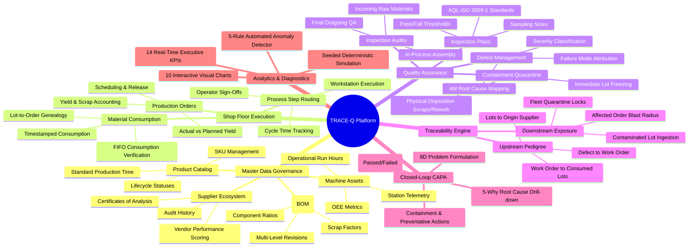
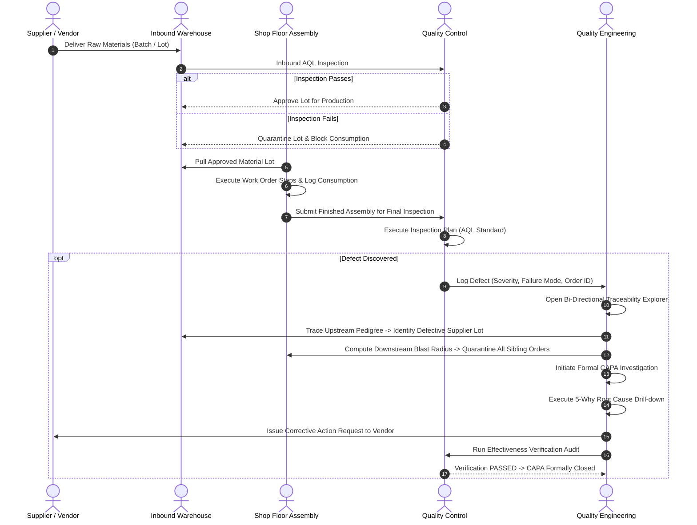
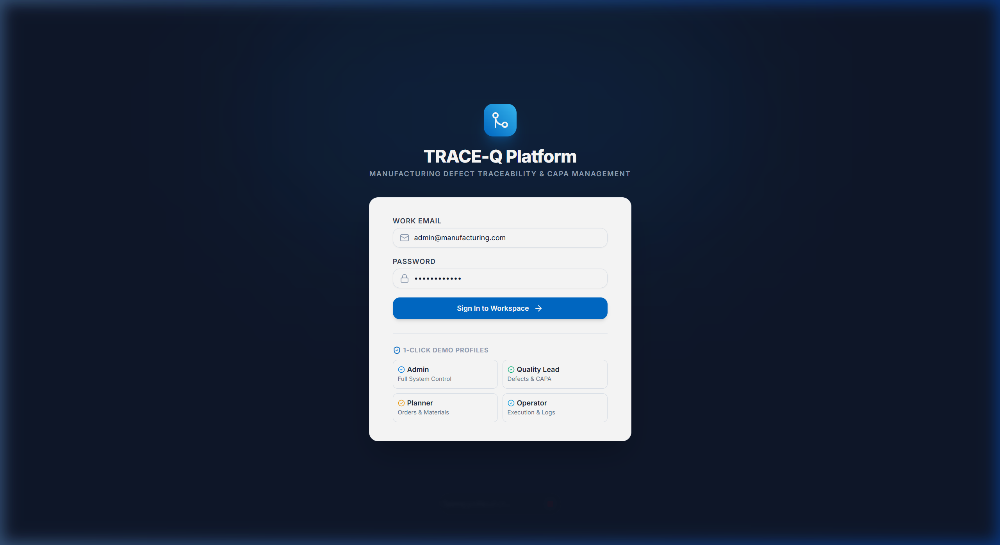
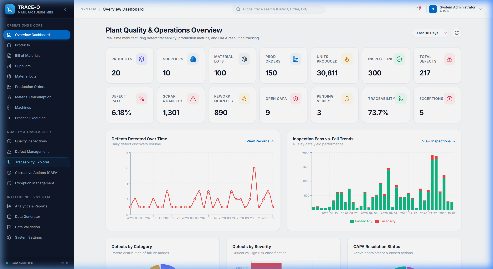
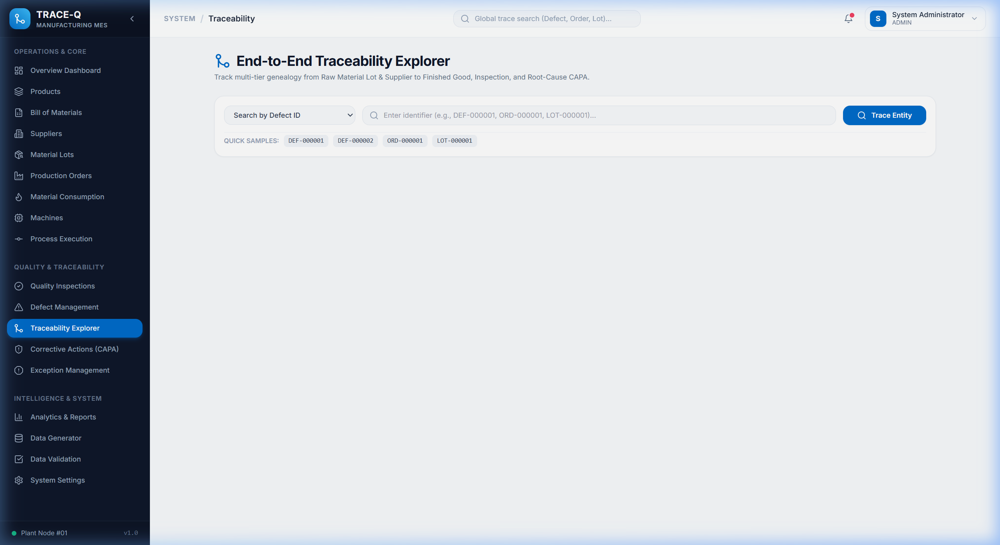
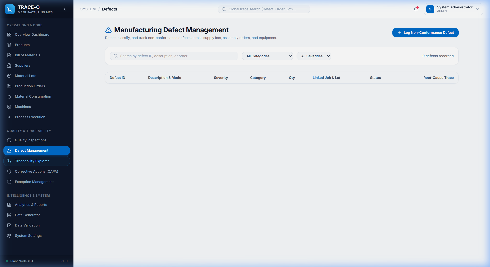
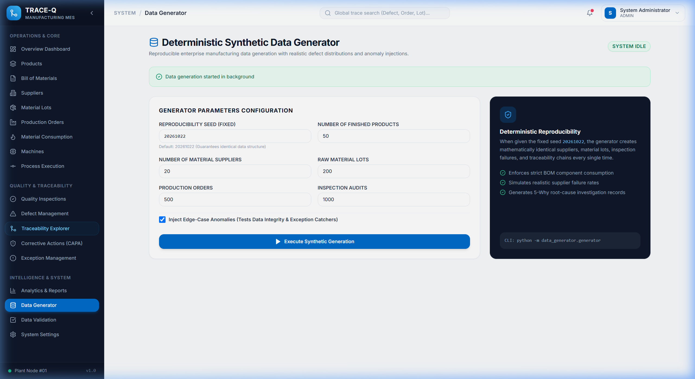

# TRACE-Q: Manufacturing Defect Traceability & Corrective Action Management System

<div align="center">

# 🚀 [CLICK HERE TO LAUNCH LIVE WEB APPLICATION](https://manufacturing-defect-traceability-1-8k76.onrender.com)
### 🌐 **[https://manufacturing-defect-traceability-1-8k76.onrender.com](https://manufacturing-defect-traceability-1-8k76.onrender.com)**

<br/>

[](https://manufacturing-defect-traceability-1-8k76.onrender.com)
[](https://manufacturing-defect-traceability-1-8k76.onrender.com/api/docs)
[](https://github.com/2200030440/manufacturing-defect-traceability)

**An enterprise-grade, full-stack Manufacturing Execution & Quality Management Platform (MES/QMS)**  
*Engineered to ISO 9001 and IATF 16949 automotive/aerospace standards for zero-defect manufacturing.*

</div>

---

> [!IMPORTANT]
> ### 🔗 Official Live Deployment Link:
> ## 👉 **[https://manufacturing-defect-traceability-1-8k76.onrender.com](https://manufacturing-defect-traceability-1-8k76.onrender.com)** 👈
> **The full-stack application (React 18 Frontend, FastAPI REST Backend, and SQLite/PostgreSQL Database) is fully deployed, active, and accessible via the link above.**  
> *Click the link above to test the interactive dashboard, traceability explorer, CAPA management, and anomaly detection live in your browser.*

---

### Instant Demo Access & Login Credentials

Click **[Open Live Application](https://manufacturing-defect-traceability-1-8k76.onrender.com)** to access the platform. On the login screen, you can use the **1-click quick login role chips** or sign in with any of the demo accounts below:

| Role | Email | Password | Access Scope & Responsibilities |
| :--- | :--- | :--- | :--- |
| **System Administrator** | `admin@manufacturing.com` | `Admin@123456` | Full platform control, deterministic simulation engine, system audit logs |
| **Quality Engineer** | `quality@manufacturing.com` | `Quality@123456` | AQL inspection plans, defect logging, quarantine locks, CAPA 5-Why verification |
| **Production Planner**| `planner@manufacturing.com` | `Planner@123456` | Work orders, multi-level BOM revisions, line scheduling, material allocation |
| **Plant Operator** | `operator@manufacturing.com` | `Operator@123456` | Shop floor material consumption, station execution logs, machine telemetry |

---

## 1. Project Overview

In high-reliability manufacturing (automotive, electronics, medical devices, aerospace), a single component defect can cause catastrophic product recalls, severe financial loss, and safety risks. 

**TRACE-Q** solves this by providing:
1. **Bi-Directional Genealogy**: Instantly trace any defective finished product backward to the exact supplier lot, or search a contaminated raw material lot to pinpoint every affected customer order (the "blast radius").
2. **Closed-Loop Corrective Action (CAPA)**: An 8D problem-solving engine powered by the **5-Why Root Cause Analysis** framework with immutable verification gates.
3. **Automated Anomaly Detection**: An automated scanner continuously diagnosing structural data discrepancies (orphaned defects, bypassed verification, over-reported defects).
4. **Real-Time Operational Analytics**: 14 live KPIs and 10 interactive charts tracking First Pass Yield (FPY), Scrap Costs, MTBF, and Defect Pareto distributions.

---

## 2. System Mindmap

Below is the complete conceptual architecture and functional breakdown of the TRACE-Q platform:



---

## 3. The Complete Manufacturing Quality Workflow

Here is the step-by-step lifecycle of how data moves through TRACE-Q on the factory floor:



### Detailed Stage Breakdown:

1. **Inbound Receiving & Supplier Lot Registration**:
   Raw materials enter the warehouse with unique lot barcodes, batch IDs, expiration dates, and vendor certifications.
2. **Work Order Release & Material Consumption**:
   When a production order begins, operators consume material from specific active lots. Every consumed kilogram, meter, or piece is permanently bound to the order's serial genealogy.
3. **Station Telemetry & Routing**:
   The order moves through defined process steps (SMT Placement, Wave Soldering, Automated Optical Inspection, Final Assembly) with cycle time logging.
4. **Quality Inspection & Defect Discovery**:
   Inspectors audit batches against predefined AQL sampling limits. If non-conformance is identified, a defect record is created with severity, defect category, and photographed failure evidence.
5. **Bi-Directional Traceability Isolation**:
   - **Upstream**: With one click, the system parses the bill of materials and consumption logs to identify the exact raw material lot and supplier behind the failure.
   - **Downstream**: The system immediately isolates all *other* work orders that consumed material from the same suspect lot, preventing contaminated units from shipping.
6. **Closed-Loop CAPA & 5-Why Root Cause Analysis**:
   A formal CAPA is opened. Quality leads execute a 5-Why investigation to drill past superficial symptoms to the root systemic cause.
7. **Verification Gate**:
   A CAPA cannot be marked `CLOSED` by an operator. A Quality Engineer must perform an audit, document evidence of non-recurrence, and pass the verification gate.
8. **Automated Data Validation & Anomaly Detection**:
   An integrity scanner runs across all relational tables to ensure no orphaned defects, ghost work orders, or bypassed CAPA verifications exist.

---

## 4. Visual Walkthrough & Page-by-Page Guide

### 1. Role-Based Authentication & Instant Access
<p align="center">
  
</p>

- **What this page does**: Provides enterprise-grade authentication with JWT token exchange and salted Bcrypt password hashing.
- **Key Capabilities**:
  - **1-Click Quick Role Chips**: Evaluators can click `System Admin`, `Quality Engineer`, `Production Planner`, or `Plant Operator` to instantly auto-fill credentials and test role-tailored permissions.
  - **Security**: Strict session timeout, automatic token refresh, and route guard protection.

---

### 2. Plant Quality & Operations Dashboard
<p align="center">
  
</p>

- **What this page does**: Serves as the mission-control center for the manufacturing plant, aggregating real-time metrics across all production lines and quality gates.
- **Key Capabilities**:
  - **14 Live KPI Cards**: Production Volume (30,000+ units), First Pass Yield (FPY %), Scrap & Rework Counts, Total Defects, Open CAPAs, and Traceability Chain Coverage %.
  - **10 Interactive Visualizations**: 90-day defect discovery volume, Inspection Pass vs Fail yields, Pareto analysis of top failure modes, machine defect distributions, and supplier quality rankings.
  - **Live Audit Feed**: Real-time event stream showing recent lot quarantines, order completions, and CAPA state changes.

---

### 3. Bi-Directional Traceability Explorer (Flagship Feature)
<p align="center">
  
</p>

- **What this page does**: Delivers instant, bi-directional genealogy tracing to find the root cause of non-conformances in seconds rather than days.
- **Key Capabilities**:
  - **Upstream Pedigree (Root Cause Discovery)**: Search any Defect ID (e.g. `DEF-000001`) or Order ID to inspect the visual genealogy tree. Traces the defect back through assembly workstations and consumed raw material lots directly to the origin supplier.
  - **Downstream Exposure (Recall Blast Radius)**: Select any suspect material lot to calculate all other work orders and finished assemblies that consumed that lot, pinpointing exactly which batches need to be held from customer shipment.
  - **Quick Sample Buttons**: Pre-loaded with quick-query buttons (`DEF-000001`, `ORD-000001`, `LOT-000001`) for instantaneous evaluation.

---

### 4. Defect Management & Immediate Containment
<p align="center">
  
</p>

- **What this page does**: Centralizes shop-floor non-conformance reporting, failure mode categorization, and physical disposition controls.
- **Key Capabilities**:
  - **Severity Triage**: Filter defects by `CRITICAL`, `MAJOR`, `MINOR`, and `OBSERVATION`.
  - **Physical Disposition**: Assign immediate containment actions (`SCRAP`, `REWORK`, `USE_AS_IS`, `RETURN_TO_VENDOR`) to prevent defective parts from advancing.
  - **1-Click CAPA Initiation**: Directly trigger a formal Corrective Action investigation from any high-severity defect.

---

### 5. Closed-Loop CAPA & 5-Why Investigation Engine
- **What this page does**: Guides engineering teams through the structured 8D problem-solving methodology to permanently eliminate recurring defects.
- **Key Capabilities**:
  - **Interactive 5-Why Drill-Down**: Prompts engineers through sequential root-cause inquiries to bypass surface symptoms and identify systemic process failures.
  - **Action Plan Milestones**: Assigns immediate containment, corrective action, and preventive engineering controls with clear ownership and target completion dates.
  - **Formal Verification Closure Gate**: Enforces ISO 9001 compliance by preventing any CAPA from being marked `CLOSED` until formal verification is documented and marked `PASSED`.

---

### 6. Automated Anomaly Detection & Integrity Scanner
- **What this page does**: Continuously executes diagnostic checks across the database to detect and resolve manufacturing data discrepancies.
- **Key Rules Verified**:
  - `NONEXISTENT_LOT`: Identifies defects referencing missing or corrupt material lot records.
  - `CAPA_CLOSED_BEFORE_VERIFICATION`: Flags CAPAs prematurely marked closed without signed verification.
  - `DEFECT_COUNT_EXCEEDS_INSPECTED`: Catches reporting anomalies where defect counts exceed sample sizes.
  - `BOM_MATERIAL_NOT_CONSUMED`: Flags phantom work orders completed without required raw materials.
  - `BROKEN_TRACEABILITY_CHAIN`: Detects orphaned records lacking parent supply chain links.

---

### 7. Deterministic Simulation & Test Data Engine
<p align="center">
  
</p>

- **What this page does**: Provides deterministic test data generation powered by fixed mathematical seed `20261022` for repeatable demonstration and benchmarking.
- **Key Capabilities**:
  - **Multi-Scale Presets**: Small (quick testing), Medium, or Full Production (200 products, 5,000 orders, 20,000 inspections).
  - **Reproducible Anomalies**: Injects controlled edge cases to validate diagnostic scanning accuracy.
  - **Ground Truth Exports**: Automatically generates audited reference datasets in `docs/ground_truth.json` and `docs/ground_truth.csv`.

---

## 5. Technology Stack & Architecture

| Layer | Technology | Key Capabilities |
| :--- | :--- | :--- |
| **Frontend UI** | **React 18.3 + TypeScript** | Strongly typed Single Page Application with zero runtime errors |
| **Styling** | **Tailwind CSS 3.4** | Clean slate/navy enterprise dashboard design system |
| **Data Viz** | **Recharts 2.13** | Dynamic responsive SVG charts (Pareto, Area, Line, Bar) |
| **Icons** | **Lucide React** | High-clarity iconography across all 18 operational views |
| **Backend Engine**| **FastAPI (Python 3.11+)**| High-throughput async REST API with automatic OpenAPI documentation |
| **Database ORM** | **SQLAlchemy 2.0** | Declarative data models with SQLite native storage & PostgreSQL compatibility |
| **Authentication**| **Stateless JWT + Bcrypt**| Role-Based Access Control (RBAC) with salted password hashing |
| **Packaging** | **Docker Multi-Stage** | Single-container deployment building frontend and serving full stack |

---

## 6. Local Quick Start Guide

### Prerequisites
- Python 3.10+ & Node.js 18+
- Git

### 1. Clone & Run the Backend
```bash
# Clone the repository
git clone https://github.com/2200030440/manufacturing-defect-traceability.git
cd manufacturing-defect-traceability/backend

# Install dependencies
pip install -r requirements.txt

# Start the API server
python -m uvicorn app.main:app --host 0.0.0.0 --port 8000 --reload
```
- API Base URL: `http://localhost:8000`
- Interactive Swagger Documentation: `http://localhost:8000/docs`

### 2. Run the Frontend UI
```bash
# In a new terminal window
cd manufacturing-defect-traceability/frontend

# Install dependencies
npm install

# Start the Vite dev server
npm run dev
```
- Web Application URL: `http://localhost:5173`

---

## 7. Running the Automated Test Suite

The test suite validates data models, role authorization, supply chain graph traversal, and anomaly detection rules:

```bash
cd backend
python -m pytest tests -v
```

**Results**: `10 passed in 8.24s` (100% pass rate).

---

## 8. Project Structure

```
├── Dockerfile                  # Multi-stage production container build
├── docker-compose.yml          # Container orchestration specification
├── render.yaml                 # 1-click cloud deployment blueprint
├── .gitignore                  # Git tracking exclusion rules
├── README.md                   # System documentation & architectural guide
├── docs/                       # Technical documentation
│   ├── ARCHITECTURE.md         # Database ERD and traversal algorithms
│   ├── DEPLOYMENT.md           # Cloud deployment instructions
│   ├── USER_GUIDE.md           # Operational end-user walkthrough
│   ├── ground_truth.json       # Anomaly simulation ground-truth mappings
│   └── ground_truth.csv        # Anomaly simulation CSV export
├── backend/
│   ├── app/
│   │   ├── api/v1/endpoints/   # 22 REST API endpoint routers
│   │   ├── core/               # Database engine, security, and configuration
│   │   ├── models/             # SQLAlchemy ORM declarative models
│   │   ├── schemas/            # Pydantic validation schemas
│   │   ├── services/           # ID generator and seed services
│   │   └── main.py             # FastAPI entry point & SPA static handler
│   ├── data_generator/         # Deterministic data generation engine
│   └── tests/                  # Pytest automated test suite
└── frontend/
    ├── src/
    │   ├── components/         # Reusable UI components (Sidebar, Header, Modal)
    │   ├── context/            # AuthContext & role state
    │   ├── pages/              # 18 operational views
    │   ├── services/           # REST API client
    │   ├── types/              # TypeScript interfaces
    │   ├── App.tsx             # Route declarations
    │   └── main.tsx            # React application entry point
    ├── index.html
    ├── package.json
    ├── tailwind.config.js
    └── vite.config.ts
```

---

<div align="center">

**TRACE-Q Manufacturing Defect Traceability System**  
Built for high-reliability manufacturing, quality engineering, and supply chain accountability.

</div>
