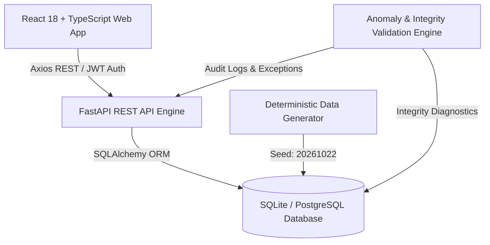

# TRACE-Q: Manufacturing Defect Traceability & Corrective Action Management System

[](https://www.python.org/)
[](https://fastapi.tiangolo.com/)
[](https://react.dev/)
[](https://www.typescriptlang.org/)
[](https://tailwindcss.com/)
[]()

> **TRACE-Q** is an enterprise-grade, full-stack manufacturing execution and quality management platform designed for defect genealogy, bi-directional traceability, and automated Corrective and Preventive Action (CAPA) lifecycle management.

---

## Table of Contents

- [Key Capabilities](#key-capabilities)
- [System Architecture](#system-architecture)
- [Technology Stack](#technology-stack)
- [Quick Start Guide](#quick-start-guide)
  - [Prerequisites](#prerequisites)
  - [Backend Setup](#backend-setup)
  - [Frontend Setup](#frontend-setup)
- [Synthetic Data Generator (Seed: 20261022)](#synthetic-data-generator-seed-20261022)
- [Running Automated Tests](#running-automated-tests)
- [Demo Credentials & RBAC Matrix](#demo-credentials--rbac-matrix)
- [Core Workflows](#core-workflows)
  - [1. Bi-Directional Traceability](#1-bi-directional-traceability)
  - [2. CAPA & 5-Why Root Cause Analysis](#2-capa--5-why-root-cause-analysis)
  - [3. Automated Anomaly Detection](#3-automated-anomaly-detection)
- [API Documentation](#api-documentation)
- [Project Structure](#project-structure)

---

## Key Capabilities

1. **Product & BOM Management**: Hierarchical multi-level Bills of Materials with revisions, component scrap factors, and unit quantities.
2. **Supplier & Material Lot Governance**: Material receipt tracking, expiration dates, supplier quality ratings, and lot quarantine locking.
3. **Production Order Tracking**: Real-time order scheduling, status transitions (`PLANNED` -> `IN_PROGRESS` -> `COMPLETED`), and yield vs scrap tracking.
4. **Lot-to-Order Genealogy**: Direct material consumption auditing linking supplier lots to production batches and shop floor steps.
5. **Shop Floor Telemetry**: Machine status monitoring (OEE, operational hours, maintenance alerts) and step-by-step execution logging.
6. **AQL Quality Inspections**: Sampling plan execution with Acceptable Quality Limit (AQL) standards and pass/fail thresholds.
7. **Defect Tracking & Containment**: Defect categorization by severity, failure modes, affected components, and immediate containment quarantine.
8. **Bi-Directional Traceability Explorer**:
   - **Upstream Pedigree**: Trace a defective unit back through production steps, machines, and consumed raw material lots to the origin supplier.
   - **Downstream Blast Radius**: Immediately locate all other work orders, finished products, and shipped inventory containing contaminated material lots.
9. **CAPA Management**: Closed-loop 8D/CAPA workflow with 5-Why root cause analysis, action plan milestones, and formal verification gates (`PENDING` -> `PASSED`/`FAILED`).
10. **Data Integrity & Anomaly Detection**: Engine validating 5 structural integrity anomaly patterns:
    - `NONEXISTENT_LOT`: Defects referencing invalid material lots.
    - `CAPA_CLOSED_BEFORE_VERIFICATION`: Premature closure bypassing verification gates.
    - `DEFECT_COUNT_EXCEEDS_INSPECTED`: Violation of physical sample sizes.
    - `BOM_MATERIAL_NOT_CONSUMED`: Production orders missing required BOM materials.
    - `BROKEN_TRACEABILITY_CHAIN`: Disconnected defect-to-lot records.
11. **Live Analytics & KPI Dashboard**: 14 real-time metrics (Defect Rate, FPY, Scrap Cost, MTBF, CAPA closure cycle) and 10 interactive charts.

---

## System Architecture



---

## Technology Stack

- **Backend**:
  - [FastAPI](https://fastapi.tiangolo.com/): High-performance async Python web framework.
  - [SQLAlchemy 2.0](https://www.sqlalchemy.org/): Declarative ORM supporting SQLite and PostgreSQL.
  - [Pydantic v2](https://docs.pydantic.dev/): Strict data validation and serialization.
  - [Pytest](https://pytest.org/): End-to-end integration and data integrity test suite.
  - [Bcrypt & Python-Jose](https://github.com/pyca/bcrypt/): Native secure password hashing and JWT token handling.
- **Frontend**:
  - [React 18](https://react.dev/) + [TypeScript](https://www.typescriptlang.org/): Strict-typed modular UI.
  - [Vite](https://vitejs.dev/): Next-generation frontend tooling and bundler.
  - [Tailwind CSS](https://tailwindcss.com/): Enterprise slate and navy design system.
  - [Recharts](https://recharts.org/): Dynamic charts for yields, pareto defect distributions, and trends.
  - [Lucide Icons](https://lucide.dev/): Intuitive iconography across all 18 operational views.

---

## Quick Start Guide

### Prerequisites
- Python 3.10, 3.11, 3.12, 3.13, or 3.14
- Node.js 18+ and npm
- Git

### Backend Setup

1. **Navigate to the backend directory**:
   ```bash
   cd backend
   ```

2. **Install Python dependencies**:
   ```bash
   pip install -r requirements.txt
   ```

3. **Initialize Database & Master Records**:
   ```bash
   python -c "from app.core.database import init_db; init_db()"
   ```

4. **Start the FastAPI server**:
   ```bash
   uvicorn app.main:app --host 0.0.0.0 --port 8000 --reload
   ```
   The backend API will be live at: **http://localhost:8000**  
   Interactive Swagger documentation: **http://localhost:8000/docs**

---

### Frontend Setup

1. **Navigate to the frontend directory**:
   ```bash
   cd frontend
   ```

2. **Install Node modules**:
   ```bash
   npm install
   ```

3. **Start the Vite development server**:
   ```bash
   npm run dev
   ```
   The web application will open at: **http://localhost:5173**

*(Optional) To build and preview production frontend bundle:*
```bash
npm run build
npm run preview
```

---

## Synthetic Data Generator (Seed: 20261022)

The system includes a deterministic synthetic data generator producing realistic manufacturing data with reproducible anomalies.

### Running via CLI:
```bash
cd backend

# Quick development dataset (small scale, clean old data):
python data_generator/generator.py --scale small --clean

# Medium enterprise dataset:
python data_generator/generator.py --scale medium --clean

# Full production benchmark (200 products, 5,000 orders, 20,000 inspections):
python data_generator/generator.py --scale full --clean
```

### Running via Web UI:
1. Log in as an **Admin** user.
2. Navigate to **Data Generator** in the sidebar.
3. Configure target counts, toggle anomaly injection, and click **Start Generation**.
4. The generation runs asynchronously with live status monitoring.

Generated ground-truth anomaly documentation is saved automatically to `docs/ground_truth.json` and `docs/ground_truth.csv`.

---

## Running Automated Tests

Run the full automated integration test suite:

```bash
cd backend
python -m pytest tests -v
```

### Test Coverage Highlights:
- `test_auth.py`: JWT token generation, role verification, password hashing, and invalid credential rejections.
- `test_products_bom.py`: Product SKU registration, material creation, and BOM tree relationships.
- `test_traceability.py`: Bi-directional traversal from supplier raw lot -> production order -> defect.
- `test_capa_workflow.py`: Defect creation, CAPA initiation, 5-Why analysis submission, and formal verification gates.
- `test_validation.py`: Database primary key uniqueness checks and the 5 anomaly detection patterns.

---

## Demo Credentials & RBAC Matrix

The system includes 4 pre-configured demo user accounts covering distinct operational roles:

| Role | Email | Password | Permissions & Scope |
| :--- | :--- | :--- | :--- |
| **System Administrator** | `admin@manufacturing.com` | `Admin@123456` | Full platform access, data generator, user management, system settings |
| **Quality Engineer** | `quality@manufacturing.com` | `Quality@123456` | Inspection plans, defect logging, quarantine containment, CAPA management |
| **Production Planner**| `planner@manufacturing.com` | `Planner@123456` | Work orders, scheduling, BOM revisions, material allocation |
| **Plant Operator** | `operator@manufacturing.com` | `Operator@123456` | Material consumption logging, shop floor step execution, machine status |

*Quick login buttons are available directly on the login screen for instantaneous testing.*

---

## Core Workflows

### 1. Bi-Directional Traceability
- **Upstream Pedigree**: In the **Traceability Explorer**, search for any Defect ID (e.g., `DEF-000001`) or Order ID. The interactive tree displays the product, order batch, consumed material lots, and origin supplier with contact and rating details.
- **Downstream Blast Radius**: When a material lot is flagged as contaminated or quarantined, the explorer instantly computes all other production orders that consumed parts from that lot and highlights potential customer exposure.

### 2. CAPA & 5-Why Root Cause Analysis
- When critical or recurring defects are identified, initiate a formal **CAPA**.
- Fill in the **5-Why Root Cause Analysis** drill-down:
  1. *Why did the motor overheat?* (Bearing friction)
  2. *Why was there bearing friction?* (Inadequate lubrication)
  3. *Why was lubrication inadequate?* (Automatic dispenser nozzle clogged)
  4. *Why was the nozzle clogged?* (Viscosity exceeded filter specification)
  5. *Root Cause*: (Material supplier changed lubricant formulation without notification)
- Assign preventive actions and target implementation dates.
- Submit for **Effectiveness Verification**. A CAPA cannot be marked `CLOSED` until verification passes.

### 3. Automated Anomaly Detection
- Navigate to **Data Validation** to run the 5-rule diagnostic engine.
- Detect anomalies such as broken traceability chains, premature CAPA closure, or BOM consumption discrepancies with one-click resolution.

---

## API Documentation

The backend serves an interactive OpenAPI / Swagger UI at:
**`http://localhost:8000/docs`**

Key REST endpoint groups:
- `/api/v1/auth`: Authentication and user profile.
- `/api/v1/products` & `/api/v1/bom`: Products and multi-level bills of materials.
- `/api/v1/suppliers` & `/api/v1/material-lots`: Supplier records and lot inventory.
- `/api/v1/production-orders` & `/api/v1/consumption`: Manufacturing batches and genealogy.
- `/api/v1/machines` & `/api/v1/process-steps`: Machine telemetry and station execution.
- `/api/v1/inspections`: Quality inspection plans and AQL results.
- `/api/v1/defects` & `/api/v1/containments`: Defect logging and quarantine actions.
- `/api/v1/capa`: Closed-loop Corrective and Preventive Actions.
- `/api/v1/traceability`: Upstream and downstream graph traversal.
- `/api/v1/validation`: Automated data validation and anomaly detection.
- `/api/v1/analytics` & `/api/v1/dashboard`: KPI metrics and chart feeds.
- `/api/v1/data-generator`: Seeded synthetic data management.

---

## Project Structure

```
├── backend/
│   ├── app/
│   │   ├── api/v1/endpoints/   # 22 REST API endpoint modules
│   │   ├── core/               # Database, security (bcrypt/JWT), config
│   │   ├── models/             # SQLAlchemy ORM declarative models
│   │   ├── schemas/            # Pydantic request/response schemas
│   │   └── main.py             # FastAPI application entry point
│   ├── data_generator/         # Deterministic synthetic data generator
│   └── tests/                  # Pytest test suite (10 automated tests)
├── frontend/
│   ├── src/
│   │   ├── components/         # Reusable UI components (Sidebar, Header, Modal, Badges)
│   │   ├── context/            # AuthContext & state management
│   │   ├── pages/              # 18 interactive views
│   │   ├── services/           # Axios API client
│   │   ├── types/              # TypeScript interfaces
│   │   ├── App.tsx             # Route configuration
│   │   └── main.tsx            # React application root
│   ├── index.html
│   ├── package.json
│   ├── tailwind.config.js
│   └── vite.config.ts
├── docs/                       # Architecture specs & ground-truth anomaly datasets
└── README.md                   # System documentation
```
