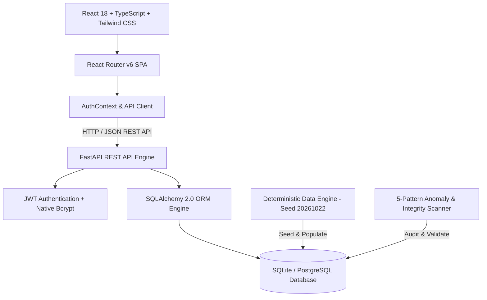

# TRACE-Q: Manufacturing Defect Traceability & Corrective Action Management System

[](https://fastapi.tiangolo.com/)
[](https://react.dev/)
[](https://www.typescriptlang.org/)
[](https://tailwindcss.com/)
[](https://www.python.org/)
[](https://www.docker.com/)

> **TRACE-Q** is a production-ready, full-stack Manufacturing Execution & Quality Management System (MES/QMS). It provides end-to-end bi-directional genealogy traceability, automated anomaly detection, closed-loop Corrective and Preventive Action (CAPA) tracking with 5-Why root cause inquiry, and real-time operational analytics aligned with **ISO 9001** and **IATF 16949** standards.

---

## Repository & Live Deployment

- **GitHub Repository**: [https://github.com/2200030440/manufacturing-defect-traceability](https://github.com/2200030440/manufacturing-defect-traceability)
- **Deployment Specification**: Pre-configured [render.yaml](render.yaml) and multi-stage [Dockerfile](Dockerfile) for zero-config 1-click cloud deployment.

---

## Table of Contents

1. [Key Features](#key-features)
2. [System Architecture](#system-architecture)
3. [Technology Stack](#technology-stack)
4. [Live Cloud Deployment (Render)](#live-cloud-deployment-render)
5. [Local Development & Setup](#local-development--setup)
6. [Demo Accounts & RBAC Matrix](#demo-accounts--rbac-matrix)
7. [Deterministic Simulation Engine](#deterministic-simulation-engine)
8. [Automated Testing Suite](#automated-testing-suite)
9. [Core Operational Workflows](#core-operational-workflows)
10. [REST API Directory](#rest-api-directory)
11. [Project Directory Layout](#project-directory-layout)

---

## Key Features

### 1. Multi-Level BOM & Product Catalog
- Hierarchical Bills of Materials with revision tracking, scrap allowances, and component quantities.
- Active lifecycle state machine: `DRAFT` &rarr; `ACTIVE` &rarr; `PHASE_OUT` &rarr; `OBSOLETE`.

### 2. Supplier & Material Lot Governance
- Inbound lot verification, expiration tracking, certificates of analysis, and vendor quality ratings.
- Strict quarantine locks preventing non-conforming lots from entering production lines.

### 3. Work Order Execution & Lot Genealogy
- Order status scheduling (`PLANNED`, `IN_PROGRESS`, `COMPLETED`, `CANCELLED`).
- Unit-level lot consumption logs directly linking raw material supplier lots to work order serials.

### 4. Shop Floor Telemetry & Machine Monitoring
- Real-time station telemetry, operational hours, line assignments, and Overall Equipment Effectiveness (OEE).
- Workstation step execution routing with cycle time measurements.

### 5. Quality Inspection & AQL Standards
- Sampling plans adhering to ISO 2859-1 Acceptable Quality Limit (AQL) standards.
- Real-time pass/fail categorization with automatic lot containment triggers.

### 6. Defect Logging & Failure Mode Analysis
- Defect capture categorized by severity (`CRITICAL`, `MAJOR`, `MINOR`, `OBSERVATION`).
- Root cause attribution across Material, Machine, Method, and Environmental vectors.

### 7. Flagship Bi-Directional Traceability Explorer
- **Upstream Pedigree**: Trace any defective unit back through assembly steps, workstations, and raw material lots directly to the vendor of origin.
- **Downstream Blast Radius**: Pinpoint all other work orders, finished products, and active inventory batches that consumed a quarantined raw lot.

### 8. Closed-Loop CAPA & 5-Why Investigation
- Structured 8D problem-solving methodology with an interactive 5-Why root cause drill-down.
- Hard verification gates: CAPAs cannot be marked `CLOSED` without documented verification evidence and a `PASSED` audit determination.

### 9. Automated Data Integrity & Anomaly Scanner
- Built-in diagnostic engine continuously validating 5 structural integrity anomaly patterns:
  - `NONEXISTENT_LOT`: Defects referencing invalid or missing material lots.
  - `CAPA_CLOSED_BEFORE_VERIFICATION`: Premature closure bypassing verification gates.
  - `DEFECT_COUNT_EXCEEDS_INSPECTED`: Defect quantity exceeding physical sample sizes.
  - `BOM_MATERIAL_NOT_CONSUMED`: Completed orders missing required BOM materials.
  - `BROKEN_TRACEABILITY_CHAIN`: Disconnected defect-to-lot records.

### 10. Operational Dashboard & Analytics
- 14 real-time KPI metrics including First Pass Yield (FPY %), Scrap Rates, Defect Rates, and MTBF.
- 10 interactive charts: 30-day trendlines, Pareto failure distributions, machine defect heatmaps, and live audit feeds.

---

## System Architecture



---

## Technology Stack

| Layer | Technologies |
| :--- | :--- |
| **Backend Framework** | [FastAPI](https://fastapi.tiangolo.com/) (Python 3.11+) |
| **Database ORM** | [SQLAlchemy 2.0](https://www.sqlalchemy.org/) (SQLite Native / PostgreSQL Production) |
| **Authentication** | Stateless JWT (HS256) + Salted Bcrypt Password Hashing |
| **Schema Validation** | [Pydantic v2](https://docs.pydantic.dev/) |
| **Testing** | [Pytest](https://pytest.org/) Integration & Data Integrity Suite |
| **Frontend Framework**| [React 18.3](https://react.dev/) + [TypeScript 5.6](https://www.typescriptlang.org/) |
| **Build Tool** | [Vite 5.4](https://vitejs.dev/) |
| **Styling** | [Tailwind CSS 3.4](https://tailwindcss.com/) Enterprise Design System |
| **Data Visualization**| [Recharts 2.13](https://recharts.org/) |
| **Icons** | [Lucide React](https://lucide.dev/) |
| **Containerization** | Docker Multi-Stage Build & Docker Compose |

---

## Live Cloud Deployment (Render)

The application includes a production-grade multi-stage [Dockerfile](Dockerfile) and [render.yaml](render.yaml) blueprint that compiles the React frontend into static assets and serves both the API and UI from a single unified container on the **Render $0 Free Tier**.

### Steps to Deploy:
1. Fork or push this repository to your GitHub account:
   ```bash
   https://github.com/2200030440/manufacturing-defect-traceability
   ```
2. Log in to [dashboard.render.com](https://dashboard.render.com/) with GitHub.
3. Click **New +** &rarr; **Web Service** (or **Blueprint**).
4. Select your repository: `manufacturing-defect-traceability`.
5. Render will automatically detect the `Dockerfile` and configure the **Docker** runtime.
6. Click **Deploy web service**.
7. In ~3 minutes, your live application will be available at:
   `https://<your-service-name>.onrender.com`

---

## Local Development & Setup

### Prerequisites
- Python 3.10, 3.11, 3.12, 3.13, or 3.14
- Node.js 18+ and npm
- Git

### 1. Backend Setup
```bash
# Navigate to the backend directory
cd backend

# Install dependencies
pip install -r requirements.txt

# Run the FastAPI server on port 8000
python -m uvicorn app.main:app --host 0.0.0.0 --port 8000 --reload
```
- **Backend API**: `http://localhost:8000`
- **Swagger Documentation**: `http://localhost:8000/docs`
- **Health Check**: `http://localhost:8000/api/health`

### 2. Frontend Setup
```bash
# In a new terminal, navigate to the frontend directory
cd frontend

# Install Node dependencies
npm install

# Start the Vite development server
npm run dev
```
- **Frontend Application**: `http://localhost:5173`

*(The Vite development server is pre-configured to reverse-proxy `/api` requests to `http://localhost:8000`).*

---

## Demo Accounts & RBAC Matrix

The system seeds four pre-configured user profiles covering standard manufacturing enterprise roles. Quick-login role chips are available directly on the login screen for instant testing:

| Role | Email | Password | Responsibilities & Access Scope |
| :--- | :--- | :--- | :--- |
| **System Admin** | `admin@manufacturing.com` | `Admin@123456` | Full platform access, simulation engine, user governance, settings |
| **Quality Engineer** | `quality@manufacturing.com` | `Quality@123456` | Inspections, defect quarantine, CAPA 5-Why analysis, verification gates |
| **Production Planner**| `planner@manufacturing.com` | `Planner@123456` | Work orders, BOM structures, schedule release, material allocation |
| **Plant Operator** | `operator@manufacturing.com` | `Operator@123456` | Material consumption logging, workstation execution, machine telemetry |

---

## Deterministic Simulation Engine

A deterministic test data engine generates realistic manufacturing records with reproducible anomaly patterns using a fixed mathematical seed (`20261022`).

### Running via CLI:
```bash
cd backend

# Quick development dataset (small scale with clean wipe):
python data_generator/generator.py --scale small --clean

# Standard dataset:
python data_generator/generator.py --scale medium --clean

# Full production benchmark (200 products, 5,000 orders, 20,000 inspections):
python data_generator/generator.py --scale full --clean
```

### Running via Web UI:
1. Log in as **System Admin**.
2. Navigate to **Data Generator** in the sidebar.
3. Configure entity counts and toggle anomaly injection.
4. Click **Start Generation** and monitor the live progress bar.

Ground-truth anomaly records are exported automatically to [docs/ground_truth.json](docs/ground_truth.json) and [docs/ground_truth.csv](docs/ground_truth.csv).

---

## Automated Testing Suite

The backend includes a comprehensive Pytest test suite covering authorization, entity integrity, supply chain traversal, CAPA state machines, and anomaly scanners.

### Run Tests:
```bash
cd backend
python -m pytest tests -v
```

### Test Suite Modules:
- `test_auth.py`: JWT generation, claims validation, Bcrypt password checking, unauthorized route rejections.
- `test_products_bom.py`: Product SKU registration, material creation, and BOM tree relationships.
- `test_traceability.py`: Bi-directional traversal from raw supplier lot &rarr; work order &rarr; defect.
- `test_capa_workflow.py`: Defect logging, CAPA opening, 5-Why analysis submission, and formal verification gates.
- `test_validation.py`: Database primary key uniqueness checks and 5 anomaly pattern detectors.

---

## Core Operational Workflows

### 1. Bi-Directional Traceability
- **Root Cause Isolation**: Search for any Defect ID (e.g. `DEF-000001`) in the **Traceability Explorer**. The interactive tree displays the product, order batch, consumed material lots, and origin supplier.
- **Exposure Blast Radius**: When an inbound material lot fails quality inspection, select the lot to visualize all downstream work orders and finished assemblies that consumed material from that lot.

### 2. Closed-Loop CAPA & 5-Why Drill-Down
- Initiate a CAPA directly from any critical or major defect.
- Complete the 5-Why root cause inquiry to identify the underlying process failure.
- Document immediate containment, corrective action, and preventive action plans.
- Submit for **Effectiveness Verification**. A CAPA cannot be transitioned to `CLOSED` until verification is verified as `PASSED`.

### 3. Automated Anomaly Detection
- Navigate to **Data Validation** to run the 5-rule diagnostic engine.
- Detect discrepancies such as broken traceability chains, premature CAPA closure, or BOM consumption variances with one-click resolution.

---

## REST API Directory

The FastAPI backend exposes 22 modular REST endpoint routers accessible via OpenAPI Swagger at `http://localhost:8000/docs`:

- `/api/v1/auth`: Authentication and current user profile
- `/api/v1/products` & `/api/v1/bom`: Products and multi-level bills of materials
- `/api/v1/suppliers` & `/api/v1/material-lots`: Supplier records and lot inventory
- `/api/v1/production-orders` & `/api/v1/consumption`: Manufacturing batches and genealogy
- `/api/v1/machines` & `/api/v1/process-steps`: Machine telemetry and station execution
- `/api/v1/inspections`: Quality inspection plans and AQL results
- `/api/v1/defects` & `/api/v1/containments`: Defect logging and quarantine actions
- `/api/v1/capa`: Closed-loop Corrective and Preventive Actions
- `/api/v1/traceability`: Upstream and downstream graph traversal
- `/api/v1/validation`: Automated data validation and anomaly detection
- `/api/v1/analytics` & `/api/v1/dashboard`: KPI metrics and chart feeds
- `/api/v1/data-generator`: Seeded simulation data management

---

## Project Directory Layout

```
├── Dockerfile                  # Multi-stage production container build
├── docker-compose.yml          # Container orchestration specification
├── render.yaml                 # 1-click cloud deployment blueprint
├── vercel.json                 # Vercel deployment configuration
├── .gitignore                  # Git tracking exclusion rules
├── README.md                   # System documentation
├── docs/                       # Technical specifications & ground truth
│   ├── ARCHITECTURE.md         # ERD, data models, and algorithm design
│   ├── DEPLOYMENT.md           # Step-by-step production deployment guide
│   ├── USER_GUIDE.md           # Operational user guide
│   ├── ground_truth.json       # Seeded simulation ground-truth anomalies
│   └── ground_truth.csv        # Seeded simulation ground-truth CSV export
├── backend/
│   ├── app/
│   │   ├── api/v1/endpoints/   # 22 REST API endpoint modules
│   │   ├── core/               # Database, security, and configuration
│   │   ├── models/             # SQLAlchemy ORM declarative models
│   │   ├── schemas/            # Pydantic request/response schemas
│   │   ├── services/           # ID generator and seed service
│   │   └── main.py             # FastAPI application entry point
│   ├── data_generator/         # Deterministic data generation engine
│   ├── tests/                  # Pytest automated test suite
│   └── requirements.txt        # Backend Python dependencies
└── frontend/
    ├── src/
    │   ├── components/         # Reusable UI components (Sidebar, Header, Modal, Badges)
    │   ├── context/            # AuthContext & role state management
    │   ├── pages/              # 18 operational views
    │   ├── services/           # Axios API client
    │   ├── types/              # TypeScript interfaces
    │   ├── App.tsx             # Application routing
    │   └── main.tsx            # React application entry point
    ├── index.html
    ├── package.json
    ├── tailwind.config.js
    └── vite.config.ts
```
