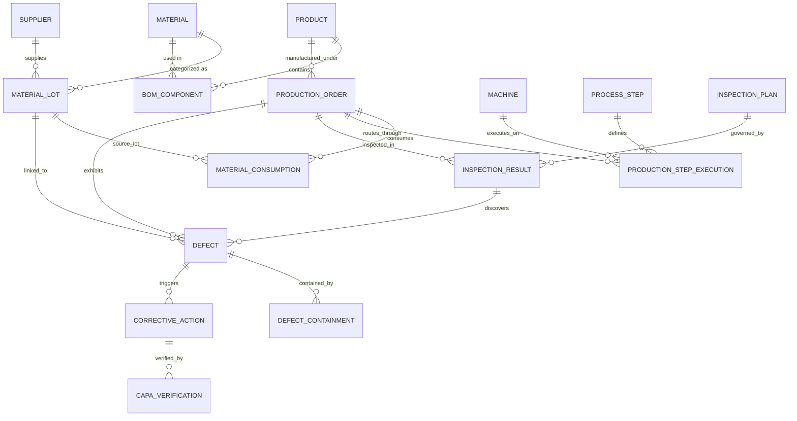

# TRACE-Q Technical Architecture & Engineering Specifications

This document outlines the data model, algorithmic genealogy traversal, anomaly detection engine, and security architecture of the **TRACE-Q Manufacturing Defect Traceability & Corrective Action System**.

---

## 1. Domain Model & Entity-Relationship Architecture

The platform models the complete manufacturing lifecycle from raw supplier material receipt to finished assembly inspection and closed-loop corrective action.

### Key Entities & Attributes

1. **Product (`products`)**:
   - `product_id` (Unique SKU/ID, e.g. `PROD-000001`)
   - `name`, `sku`, `description`, `category` (ELECTRONIC, MECHANICAL, ASSEMBLY, PACKAGING)
   - `unit_of_measurement`, `standard_production_time`, `lifecycle_status` (DRAFT, ACTIVE, PHASE_OUT, OBSOLETE)

2. **Material (`materials`)**:
   - `material_id` (e.g. `MAT-000001`)
   - `name`, `description`, `category` (RAW_MATERIAL, SUB_ASSEMBLY, PACKAGING, CONSUMABLE, CHEMICAL)
   - `unit_of_measurement`, `lifecycle_status`

3. **BOM Component (`bom_components`)**:
   - `bom_id`, `product_id`, `material_id`, `revision`
   - `required_quantity`, `unit`, `scrap_factor`, `status`

4. **Supplier (`suppliers`)**:
   - `supplier_id`, `name`, `code`, `country`, `quality_rating`, `status`, `contact_email`

5. **Material Lot (`material_lots`)**:
   - `lot_id`, `lot_number`, `material_id`, `supplier_id`, `received_date`, `expiry_date`
   - `initial_quantity`, `remaining_quantity`, `status` (PENDING, APPROVED, QUARANTINED, REJECTED)

6. **Production Order (`production_orders`)**:
   - `order_id`, `order_number`, `product_id`, `planned_quantity`, `actual_quantity`
   - `status` (PLANNED, RELEASED, IN_PROGRESS, COMPLETED, CANCELLED)
   - `start_date`, `end_date`, `yield_quantity`, `scrap_quantity`

7. **Material Consumption (`material_consumptions`)**:
   - `consumption_id`, `order_id`, `lot_id`, `step_id`, `consumed_quantity`, `timestamp`

8. **Machine (`machines`)**:
   - `machine_id`, `name`, `code`, `line`, `location`, `status`, `operating_hours`

9. **Inspection Plan & Result (`inspection_plans`, `inspection_results`)**:
   - `plan_id`, `name`, `inspection_type` (INCOMING, IN_PROCESS, FINAL, OUTGOING)
   - `aql_level`, `sample_size`
   - `result_id`, `order_id`, `inspected_quantity`, `passed_quantity`, `failed_quantity`, `status` (PASS, FAIL, CONDITIONAL)

10. **Defect & Containment (`defects`, `defect_containments`)**:
    - `defect_id`, `order_id`, `lot_id`, `inspection_id`, `severity` (CRITICAL, MAJOR, MINOR, OBSERVATION)
    - `failure_mode`, `root_cause_category`, `defect_quantity`, `status`
    - Containment: `quarantine_flag`, `disposition` (SCRAP, REWORK, USE_AS_IS, RETURN_TO_VENDOR)

11. **CAPA & Verification (`corrective_actions`, `capa_verifications`)**:
    - `capa_id`, `defect_id`, `title`, `description`, `source`, `priority`
    - 5-Why Analysis: `why_1`, `why_2`, `why_3`, `why_4`, `why_5`, `root_cause_summary`
    - `containment_action`, `corrective_action`, `preventive_action`, `status`
    - Verification: `verification_status` (PENDING, PASSED, FAILED), `effectiveness_evidence`, `verified_by`

---

## 2. Bi-Directional Genealogy Traversal Algorithm

### A. Upstream Pedigree (Defect/Order -> Raw Materials -> Suppliers)
Given a target entity (Defect or Finished Order):
1. Resolve associated `production_order_id`.
2. Query `material_consumptions` matching `order_id` to retrieve all consumed `lot_ids`.
3. Join `material_lots` on `lot_id` to retrieve batch receipt dates, shelf life, and inspection records.
4. Join `suppliers` on `supplier_id` to pinpoint the vendor of origin, supplier quality score, and audit logs.
5. Trace machine routing via `production_step_executions` to identify workstation telemetry at time of assembly.

### B. Downstream Blast Radius (Contaminated Lot -> Orders -> Customer Shipments)
Given a contaminated or quarantined raw material lot:
1. Identify all `material_consumptions` where `lot_id = target_lot`.
2. Extract distinct `order_id`s representing finished or in-flight production runs.
3. Compute the **exposure blast radius**:
   - Total finished units produced using the lot.
   - Orders currently in warehouse inventory vs orders dispatched.
   - Secondary defects logged on those orders.
4. Support immediate **Fleet Quarantine Action** to lock all downstream orders simultaneously.

---

## 3. Anomaly Detection Engine

The anomaly detection engine runs five deterministic integrity checks:

| Code | Name | Detection Logic | Impact |
| :--- | :--- | :--- | :--- |
| **ANOMALY-001** | `NONEXISTENT_LOT` | `SELECT d FROM defects d LEFT JOIN material_lots m ON d.lot_id = m.id WHERE d.lot_id IS NOT NULL AND m.id IS NULL` | Data corruption; un-traceable defect |
| **ANOMALY-002** | `CAPA_CLOSED_BEFORE_VERIFICATION` | `SELECT c FROM corrective_actions c LEFT JOIN capa_verifications v ON c.id = v.capa_id WHERE c.status = 'CLOSED' AND (v.id IS NULL OR v.verification_status != 'PASSED')` | ISO 9001 / IATF 16949 audit non-conformance |
| **ANOMALY-003** | `DEFECT_COUNT_EXCEEDS_INSPECTED` | `SELECT d FROM defects d JOIN inspection_results i ON d.inspection_id = i.id WHERE d.defect_quantity > i.failed_quantity` | Physical count impossibility |
| **ANOMALY-004** | `BOM_MATERIAL_NOT_CONSUMED` | `SELECT o FROM production_orders o WHERE o.status = 'COMPLETED' AND NOT EXISTS (SELECT 1 FROM material_consumptions c WHERE c.order_id = o.id)` | Phantom production order; inventory leak |
| **ANOMALY-005** | `BROKEN_TRACEABILITY_CHAIN` | `SELECT d FROM defects d WHERE d.order_id IS NULL AND d.lot_id IS NULL AND d.inspection_id IS NULL` | Orphaned defect unable to trace upstream |

---

## 4. Security & Access Control

- **Authentication**: Stateless JSON Web Tokens (JWT) signed via HS256 secret.
- **Password Protection**: Salted Bcrypt hashing with UTF-8 byte boundary truncation.
- **RBAC Enforcement**: Fast-path dependency injection `require_role(...)` verifying user roles:
  - `admin`: Full unrestricted access.
  - `quality_engineer`: Full inspection, defect, containment, and CAPA control.
  - `production_planner`: Orders, BOM, schedule, and material lot allocation.
  - `plant_operator`: Shop floor telemetry, machine check-in, and consumption logging.
